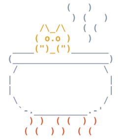

# KotelOS

Linux в одном html-файле.

> [!WARNING]
> Проект на 99.99% навайбкожен с [Claude Code](https://claude.com/claude-code).

<a href="#демо-сборки">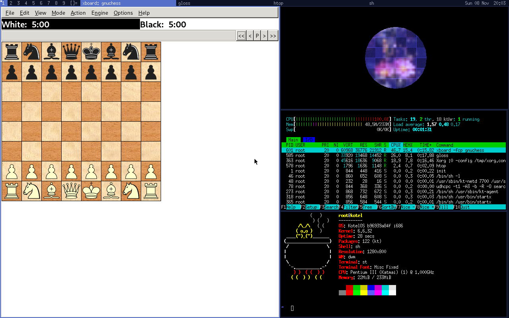</a>

## Что это

KotelOS - маленький Linux для браузера на эмуляторе [v86](https://github.com/copy/v86). Машина
целиком - ядро, система, программы и, если нужно, уже запущенное состояние - собирается в один
html-файл. Его открывают с сайта или просто двойным кликом с диска, на компьютере и на телефоне.

Недостающее ставит пакетный менеджер в работающую машину, в том числе пакеты Alpine Linux.
Машина сохраняется в браузере вместе с запущенными программами и при следующем открытии продолжает с
того же места, файлы хранятся в браузере.

На нём делают учебные стенды и демо программ: машина с нужными программами собирается одной
командой.

### English

KotelOS is a small Linux for the browser, built on the [v86](https://github.com/copy/v86) emulator.
A whole machine - kernel, system, programs and, optionally, an already running state - is packed
into a single HTML file. It opens from a website or straight from disk, on desktop and on phones.

A package manager installs more software into the running machine, including Alpine Linux
packages. The machine is saved in the browser together with its running programs and continues
where it left off next time; files live in browser storage.

It is used for teaching labs and software demos: a machine with the programs you need is built
with one command. Below are demo builds; the rest of this README is in Russian.

## Демо-сборки

Каждая - html-файл со снимком уже загруженной машины, недостающее ставит `kt pkg add`. Свою сборку делают так же, см. [Своя сборка](#своя-сборка).

<table>
<tr><td><a href="https://hugecatdev.github.io/KotelOS/python/">python</a></td><td>Python для учёбы: CPython с pip, numpy и matplotlib, IDLE, turtle, рабочий стол на tkinter, ИИ-ассистент</td></tr>
<tr><td><a href="https://hugecatdev.github.io/KotelOS/standard/">standard</a></td><td>терминал, лёгкий Python, Lua, рабочий стол, терминал в окне, ИИ-ассистент</td></tr>
<tr><td><a href="https://hugecatdev.github.io/KotelOS/micro/">micro</a></td><td>минимальный Linux: nano, htop, tmux, curl, wget</td></tr>
<tr><td><a href="https://hugecatdev.github.io/KotelOS/xorg/">xorg</a></td><td>X на экране машины: twm, xterm, xcalc и xeyes</td></tr>
<tr><td><a href="https://hugecatdev.github.io/KotelOS/dwm/">dwm</a></td><td>X с dwm: st, neofetch, часы в панели, шахматы, OpenGL на видеокарте</td></tr>
<tr><td><a href="https://hugecatdev.github.io/KotelOS/sqlite/">sqlite</a></td><td>DB Browser for SQLite из Alpine с базой пакетов этой же машины</td></tr>
<tr><td><a href="https://hugecatdev.github.io/KotelOS/qt/">qt</a></td><td>стенд для Qt: Qt Designer и PyQt5</td></tr>
</table>

### Скриншоты

<table>
<tr>
<td width="50%"><a href="https://hugecatdev.github.io/KotelOS/python/">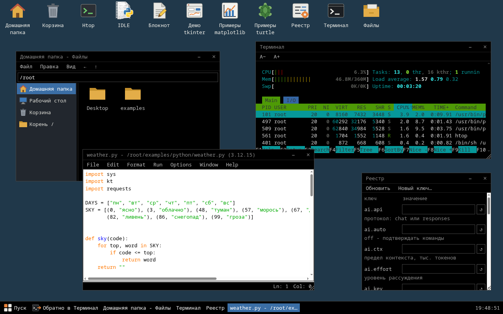</a><br>python: файлы, htop в терминале, IDLE и реестр настроек на рабочем столе tkinter</td>
<td width="50%"><a href="https://hugecatdev.github.io/KotelOS/python/">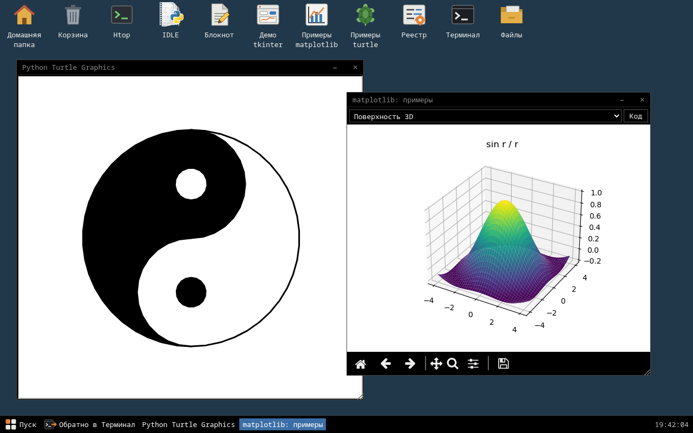</a><br>python: matplotlib и turtle в окнах tkinter</td>
</tr>
<tr>
<td><a href="https://hugecatdev.github.io/KotelOS/sqlite/">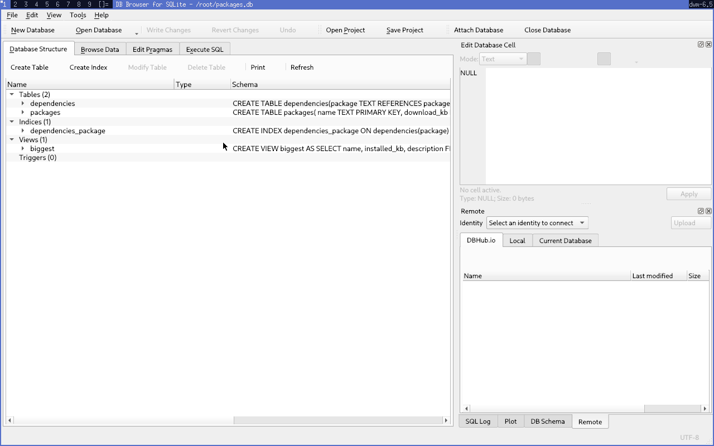</a><br>sqlite: DB Browser for SQLite</td>
<td><a href="https://hugecatdev.github.io/KotelOS/qt/">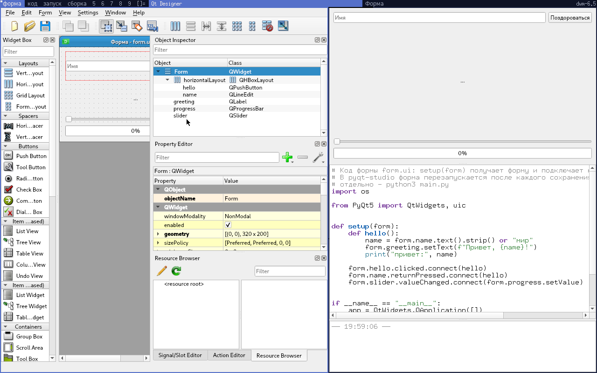</a><br>qt: Qt Designer и PyQt5</td>
</tr>
<tr>
<td><a href="https://hugecatdev.github.io/KotelOS/xorg/">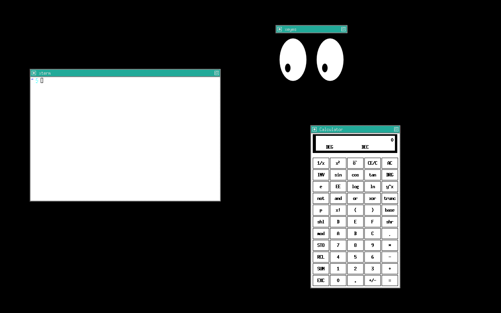</a><br>xorg: twm, xterm, xcalc, xeyes</td>
<td><a href="https://hugecatdev.github.io/KotelOS/dwm/">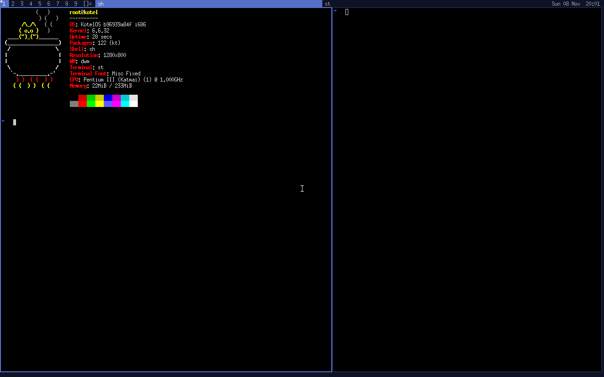</a><br>dwm: st с neofetch, рядом второй терминал, часы в панели</td>
</tr>
</table>

На телефоне - то же самое, с рядом клавиш под экраном:

<p>
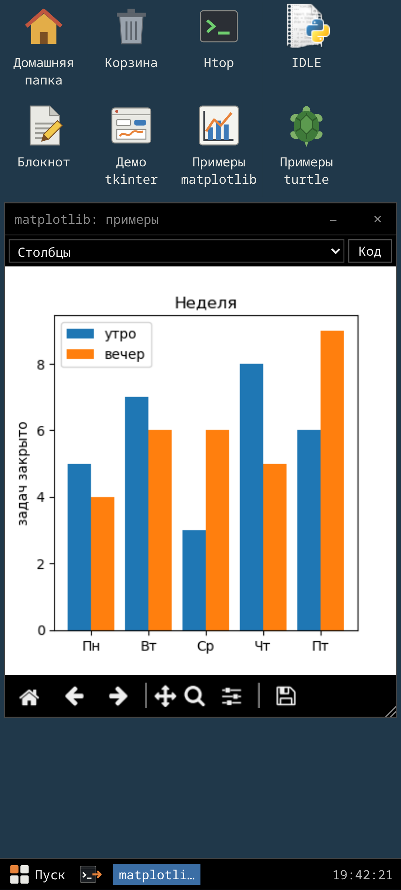
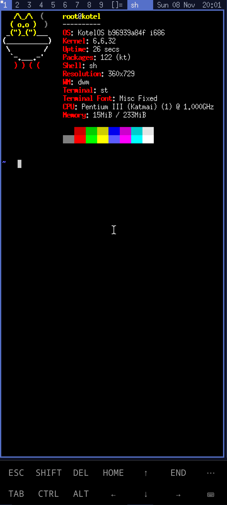
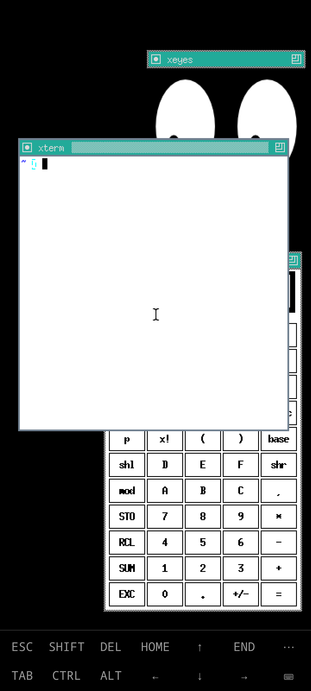
</p>

## Возможности

<table>
<tr><td>Машина в одном файле</td><td>ядро, система, программы и снимок запущенной машины - в одном html. Открывается с сайта или с диска без сети, в ту программу, что была запущена при сборке</td></tr>
<tr><td>Машина файлом другому</td><td><code>kt share</code> или кнопка на странице собирает html с машиной как она есть сейчас, со своим v86 и снимком. Другой открывает его в браузере, правит и своим <code>kt share</code> отдаёт обратно; сохранения разных проектов и ревизий не путаются</td></tr>
<tr><td>Пакетный менеджер <code>kt pkg</code></td><td>ставит, удаляет и ищет пакеты в работающей машине, с зависимостями. Свой репозиторий - программы, собранные и урезанные под эмулятор</td></tr>
<tr><td>Пакетный менеджер с поддержкой Alpine</td><td>чего нет в своём репозитории, <code>kt pkg add</code> берёт из Alpine Linux: git, gcc, nodejs, vim и почти всё остальное, с триггерами и удалением как у обычных пакетов</td></tr>
<tr><td>Сохранение состояния</td><td>машина целиком, с запущенными процессами, сохраняется в браузере и восстанавливается при следующем открытии. Именные снимки, экспорт в файл и обратно, автосохранение</td></tr>
<tr><td>Файлы</td><td><code>kt pack</code> хранит файлы в браузере между машинами, файл можно перетащить в терминал, <code>kt dl</code> и <code>kt up</code> - скачать и загрузить</td></tr>
<tr><td>Диск в браузере</td><td><code>/disk</code> - файлы лежат в хранилище браузера и читаются по требованию, в памяти машины только то, что сейчас нужно. Пакеты, которым мало памяти (gcc), <code>kt pkg add -d</code> ставит туда</td></tr>
<tr><td>Лёгкий и быстрый Python</td><td>CPython 3.12, собранный под эмулятор: <code>minipython</code> - лёгкое ядро, <code>python3</code> - целиком, тяжёлые модули - отдельными пакетами. pip ставит колёса с PyPI через браузер, а пакеты с C-кодом берёт из Alpine</td></tr>
<tr><td>pyzygote</td><td>демон, прогревающий питон и позволяющий его форкать: новый <code>python3</code> не ждёт загрузки интерпретатора и библиотек</td></tr>
<tr><td>tkinter в браузере</td><td>окна tkinter рисует сама страница, без X: IDLE и turtle работают без правок, у matplotlib свой бэкенд для этих окон; и на телефоне тоже. Бандл с <code>--embed</code> показывает их поверх своего сайта, без терминала</td></tr>
<tr><td>Рабочий стол</td><td>на чистом tkinter: файлы, блокнот, просмотр картинок, корзина, меню программ по Desktop Entry, терминал в окне, реестр настроек</td></tr>
<tr><td>Мост с браузером</td><td>Shell API (команда <code>kt</code>) и Python API (модуль <code>kt</code>): выполнить JS на странице, события страницы, буфер обмена, уведомления и диалоги браузера. Гость и страница говорят по TCP через сетевую карту машины, терминалу остаётся последовательный порт. Сайт может встроить машину в iframe и управлять ею</td></tr>
<tr><td>Телефон</td><td>ряд клавиш как в Termux, залипающие Ctrl, Alt и Shift, долгое нажатие - правая кнопка, окна ужимаются под экран, X подстраивается под размер и поворот</td></tr>
<tr><td>X и OpenGL</td><td>Xorg на экране машины, dwm, Qt5 и PyQt5; с оконным менеджером <code>kt-xwm</code> окна X - отдельными окнами страницы, тоже поверх своего сайта. OpenGL-программы рисуются на видеокарте через WebGL2 вкладки: virtio-gpu в v86 и virglrenderer в wasm</td></tr>
<tr><td>ИИ-ассистент <code>ai</code></td><td>в терминале, с любым OpenAI-совместимым API: сам выполняет команды, читает и правит файлы, знает скиллы и <code>AGENTS.md</code>. Ключ хранится в браузере и в машину не попадает</td></tr>
<tr><td>Сеть через браузер</td><td>curl, wget, requests, pip и текстовый браузер chawan ходят в интернет через fetch страницы; работают и Telegram-боты</td></tr>
<tr><td>Виртуальные консоли</td><td>Alt+1..9 переключают шеллы, у каждой консоли свой терминал на странице, консоли переживают перезагрузку страницы</td></tr>
<tr><td>Доработанный v86</td><td>эмулятор собирается из исходников с патчами: только нужные устройства, Web Worker, окно и повтор в TCP, ленивое обнуление памяти, настройки JIT, virtio-gpu, 9p с файлами в хранилище браузера</td></tr>
<tr><td>MicroPython</td><td>с тем же <code>import kt</code> и примерами: камера в терминале, синтез речи, QR-коды, погода, змейка, рисовалка на странице</td></tr>
<tr><td>И ещё</td><td>Doom на экране, OpenJDK, Node.js, Lua, Ruby, tcc, темы и шрифты терминала, часовой пояс браузера</td></tr>
</table>

## Своя сборка

Машина собирается одной командой: пакеты, свои файлы, команды перед снимком. Готовый файл
открывается с любого хостинга или просто с диска.

```sh
# только busybox и kt, остальное - kt pkg add уже в машине
python3 bundle.py --bare -o tiny.html

# питон с numpy и matplotlib; --snap - снимок уже загруженной машины
python3 bundle.py -o lab.html -n lab --cfg boot.mem=256 --snap python3 python-numpy python-matplotlib-tk

# свой файл в машину (в /root) и его запуск перед снимком: открывается уже с выводом программы
python3 bundle.py -o hello.html --file hello.py --run "python3 hello.py" python3

# экран с X; OpenGL-программы рисуются на видеокарте через WebGL2 (glxgears - в xterm)
python3 bundle.py -o gl.html --snap --vga 8 --cfg boot.mem=256 --cfg boot.cmd=startx xorg mesa-utils

# X со своей сессией (xinitrc: "sqlitebrowser & exec dwm"), снимок с уже открытым окном
# программы на Qt; машина сама сохраняется каждые 2 минуты
python3 bundle.py -o db.html --vga 8 --cfg boot.mem=256 --file xinitrc:/root/.xinitrc --run startx \
  --cfg save.timer=2 xorg dwm st sqlitebrowser

# пакет, которого нет в своём репозитории, - из Alpine
python3 bundle.py -o git.html --snap git
```

## Ограничения

- Один процессор x86 (32 бит) в эмуляторе: всё работает очень медленно, но для консольных утилит и небольших программ хватает.
- В сеть - только через fetch браузера: открываются сайты с CORS, входящих соединений нет.
- Часть инструкций SSE3 и всё новее v86 не умеет: такие бинарники падают с SIGILL.
- 3D-контекст не сохраняется в снимке: OpenGL-программу после восстановления запускают заново.

## Сборка из исходников

Нужны Linux x86-64 (ядро с поддержкой i386: собранный CPython запускается на
хосте), `python3` (с `venv`), `curl`, `xz`, `zstd`, `cpio`, `patch`, `make`, `gcc`,
`ninja` и `pkg-config` (сборка numpy); Chromium - для `--snap` и тестов, `npx` - для
сжатия js (без него остаётся как есть). Тулчейн musl.cc, исходники и Cython
скачиваются сами в `.cache/`.

```sh
scripts/build-busybox.sh   # busybox, kt-net, kt-seed, pyzygote
scripts/build-kernel.sh    # ядро -> images/bzImage
scripts/get-packages.sh    # пакеты из Alpine, свой CPython, openblas, Xorg, mesa, dwm... -> build/packages/
./build.sh                 # rootfs -> images/, репозиторий пакетов -> site/repo/
./release.py               # сборки из bundles/ -> site/ИМЯ/index.html
```

Дальше `site/` раздаётся любым http-сервером (`python3 -m http.server -d site`).
Скриншоты для этого README снимает `python3 tests/shots.py`.

## Структура

```
build.sh  bundle.py  release.py   сборка образа, бандла и всех сборок сайта
alpine.py                         индекс и пакеты Alpine (для bundle.py и скриптов)
page.html                         шаблон страницы бандла
overlay/                          своё в rootfs: kt, агент, init-скрипты, kt.py
packages/                         свои пакеты репозитория (папка = пакет)
src/                              свои бинарники на C: kt-net, kt-seed, kt-ttyd, pyzygote, doom
base/rootfs.base.cpio             базовый rootfs из Buildroot
config/                           конфиги ядра и busybox, base.exclude, описания пакетов, Buildroot
scripts/                          сборка ядра, busybox, CPython, openblas, X, mesa, v86, virgl
patches/                          правки сторонних пакетов (ядро, v86, virgl, mesa, matplotlib, dwm, Xorg)
vendor/                           собранные v86 и virglrenderer
bundles/                          описания сборок сайта для release.py
tests/                            тесты в headless Chromium
.cache/                           загрузки, исходники и деревья сборки
build/packages/                   пакеты из Alpine и собранные скриптами
images/                           собранные bzImage, rootfs.cpio, build.json
site/                             сборки и репозиторий пакетов для публикации
```

## Лицензия

MIT, см. [LICENSE](LICENSE). Сторонний код и его лицензии - в [THIRD_PARTY.md](THIRD_PARTY.md).
